# Recorrido virtual de la sala

**Avance:** 23 de octubre de 2026 · versión 0.9.2 
**Equipo:** Emilio Abarca · Emilia Armstrong · Victoria Aracena

[Volver al proyecto](https://github.com/eeminionn/labTecnologiasEmergentes)

Pasamos la propuesta espacial a Unity para recorrer la sala y entender cómo se sienten la mesa, los puestos y las proyecciones desde adentro. Nos sirve para revisar decisiones antes de llevarlas al espacio real y comparar la experiencia de pie y sentados.

## Gráficos sobre la mesa

Sumamos a la mesa la nueva secuencia del mapa gestual. Desde la silla principal, el **pin 1 de Seguridad y riesgos** abre los cinco gráficos entregados por el equipo, correspondientes a las páginas 2 a 6 del PDF. Queremos probar el paso entre el mapa y sus explicaciones dentro de la misma superficie; estos gráficos todavía son material de trabajo.

La X vuelve al mapa y las flechas recorren los gráficos, manteniendo el índice **1,5 segundos**. Conservamos el zoom con dos OK y el arrastre con un puño. También incorporamos los pines originales, separados y acompañados de su leyenda de colores; el primero pulsa suavemente y los otros dos temas siguen en preparación. Este avance corresponde a la versión de computador.

Al verlo desde la silla, los gráficos quedaban demasiado lejos. Los acercamos al puesto principal y dejamos las flechas a los lados, con la X centrada encima. También achicamos y centramos la leyenda; después de probarla otra vez, la bajamos hasta dejar la viñeta rosada casi junto al borde cercano y acercamos un poco más los gráficos. Los créditos del mapa quedaron en el menú inicial y en ajustes para despejar la mesa.

<table>
  <tr>
    <td>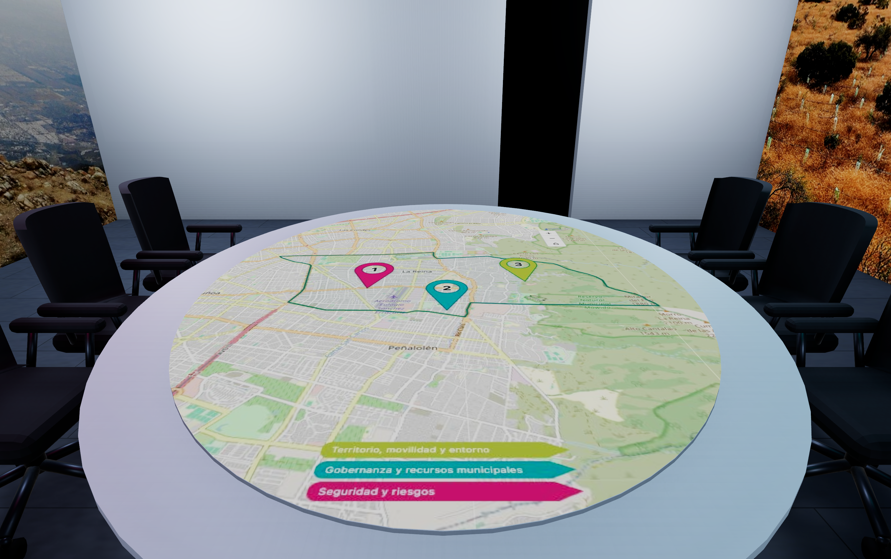</td>
    <td>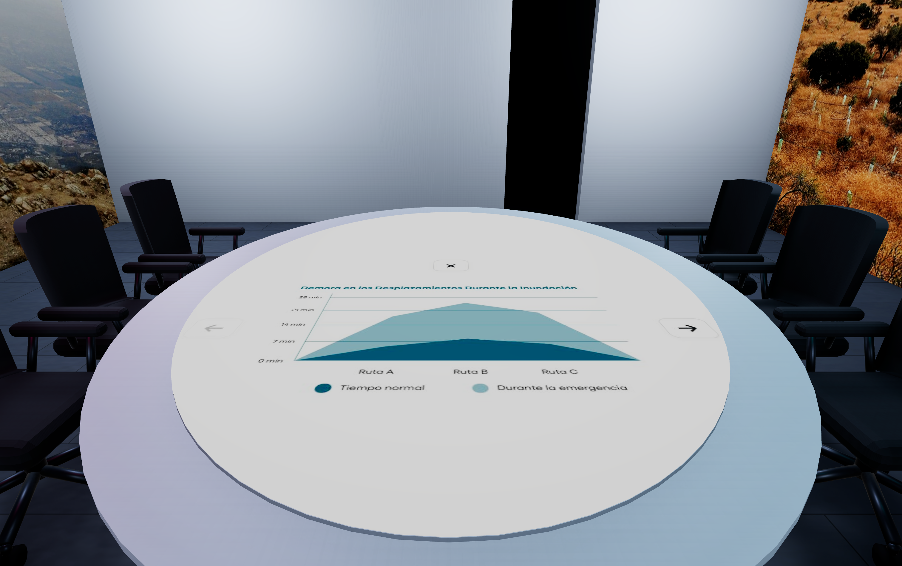</td>
  </tr>
  <tr>
    <td>Leyenda más pequeña, centrada cerca del puesto principal.</td>
    <td>Reordenamos el contenido después de probar su lectura desde la silla.</td>
  </tr>
</table>

## Ajustes al recorrido y a la lectura del mapa

Elevamos **35 cm la cámara al sentarnos en Mac**, de 1,18 a **1,53 m**, para ver mejor la mesa. Es una vista de visualización más alta, no una nueva medida de la persona sentada; las sillas y sus anclajes siguen iguales.

<table>
  <tr>
    <td>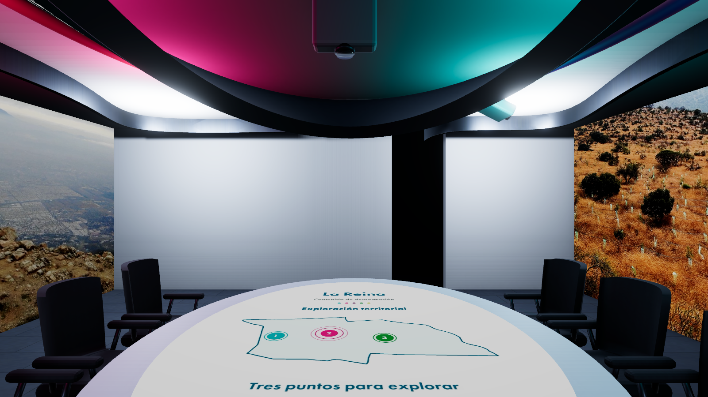</td>
  </tr>
  <tr>
    <td>Vista elevada para leer mejor el mapa desde la silla, sin cambiar el modelo.</td>
  </tr>
</table>

Al probar la mesa sentados, quisimos comparar una posición más baja del mapa. Ahora podemos bajarlo hasta **20 cm con K**; el inserto y el pedestal se adaptan para que no se atraviesen. **I** permite subirlo, **U/J** siguen moviendo la mesa completa y **0** vuelve al inicio. Los ajustes no se guardan al cerrar.

También ajustamos las luces del piso y del techo para que retomen el tramo más cercano, aunque retrocedamos o volvamos al recorrido desde otro lado. Fuera de la ruta conservan la última ubicación; al sentarnos se pausan. La luz del techo sigue adelantándose **1,35 m** para indicar hacia dónde caminar.

<table>
  <tr>
    <td>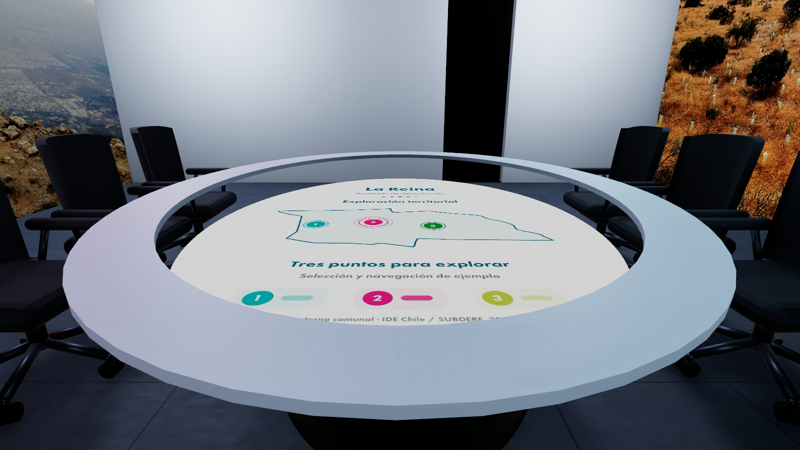</td>
  </tr>
  <tr>
    <td>Prueba del descenso de 20 cm para comparar la lectura del mapa desde la silla.</td>
  </tr>
</table>

## Mesa más delgada y guía en el techo

Tomamos del modelo actualizado de Blender la mesa más delgada y la línea orgánica del techo. El tablero ahora tiene **2,58 cm de espesor** y queda a **78,0 cm del piso**. Conservamos su tamaño, el borde blanco de 20 cm y la proyección ovalada, junto con las sillas en U que ya veníamos probando.

La línea del techo funciona como una **tira LED turquesa** sobre una estructura metálica oscura. Se enciende un tramo entre **1,35 y 2,60 m por delante** de la persona, siguiendo la curva. Queremos que indique hacia dónde avanzar, por eso la luz va adelantada y se apaga al sentarnos o pausar el recorrido. Este cambio corresponde a la versión de computador.

<table>
  <tr>
    <td>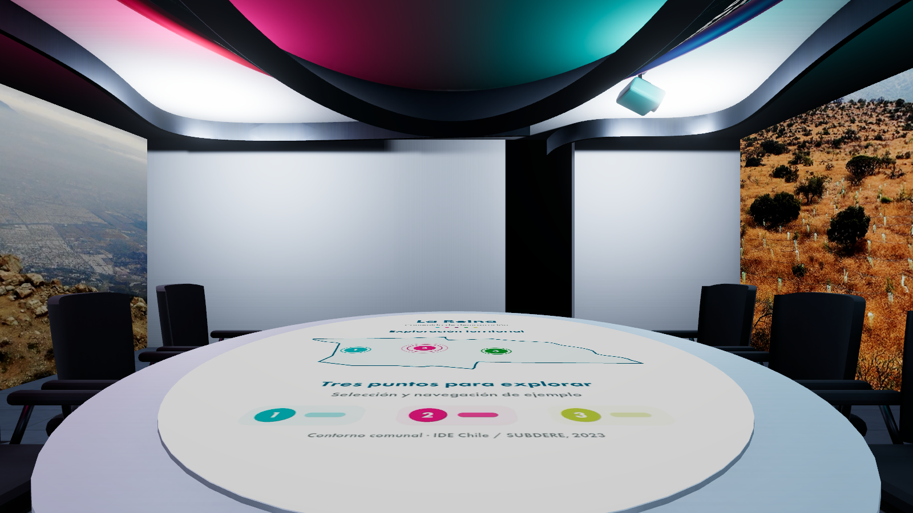</td>
  </tr>
  <tr>
    <td>Mesa del modelo actualizado, con el borde más delgado y la misma área para el mapa.</td>
  </tr>
</table>

## Una sala más inmersiva

En esta versión dejamos las paredes lisas y quitamos las divisiones, marcos y anillos que interrumpían la imagen. Unimos las proyecciones en un panorama continuo en U, de piso a techo, con las dos esquinas frente a las sillas redondeadas. La idea es que las paredes acompañen los datos con imágenes del contexto: vecinos, barrios, áreas verdes y vida de La Reina. La muestra usa fotografías publicadas por la Municipalidad y el Parque Padre Hurtado; los datos quedan en la mesa.

También cambiamos la línea azul del piso por huellas de zapatos. El recorrido rodea la mesa de izquierda a derecha desde la entrada, y las huellas se iluminan y apagan según avanzamos. Así la guía se relaciona con el movimiento de la persona.

Al revisar el recorrido, vimos que las luces parecían avanzar de a pares. Las ajustamos para marcar una huella derecha y luego una izquierda, como al caminar. También usamos la franja circular del techo como pantalla de la sesión: muestra la hora, quién está hablando y una cuenta regresiva de 15 minutos. Repetimos la información dos veces para verla desde distintos puestos y dejamos las paredes para las fotografías del contexto.

En la versión 0.4 tomamos **solo la mesa del archivo sala 002.fbx** y reacomodamos las once sillas a su alrededor. Ajustamos su apoyo en el piso sin cambiar el tamaño del mueble. También hicimos que la proyección siga la forma ovalada de la mesa, porque una imagen rectangular se salía del tablero. El contenido ahora se organiza dentro de ese contorno.

Después acercamos las sillas y volvimos a una **disposición en U**, con cuatro a cada lado y tres al fondo. Dejamos libre el lado que mira a la puerta para entrar y acercarse a la mesa con más claridad.

También conectamos el **mapa gestual en vivo** a la mesa. En Mac funciona únicamente cuando nos sentamos en la silla central del fondo, **Chair_10**, usando la cámara frontal. Conservamos los gestos que ya habíamos probado; al levantarnos o usar otra silla, se apagan la cámara y los gestos, pero la mesa mantiene la última imagen del mapa. Así podemos mirar lo que quedó seleccionado desde cualquier puesto, con un solo lugar para interactuar.

En la versión 0.6 redujimos el borde blanco de **30 a 20 cm** para darle más espacio al mapa, sin agrandar la mesa. También dejamos probar la altura de la mesa y del mapa por separado; al abrir de nuevo, se restablecen las alturas del modelo. La cámara siempre inicia en modo espejo y, al entrar a la silla principal, aparece una vista pequeña con el seguimiento de las manos. Se cierra al levantarnos.

## Escala, gráfica y puntos de vista

Revisamos las medidas antes de agrandar los muebles: mantuvimos la sala de **8 × 9 m** y las once sillas con el asiento a **47 cm**. La mesa mide **2,27 × 2,80 m**, con el tablero a **78,0 cm** del piso en el modelo actual. Podemos sentarnos virtualmente, mirar alrededor y volver a caminar. En Mac, la cámara sentada se eleva a **1,53 m** para facilitar la lectura; el anclaje original sigue a **1,18 m**. Esto nos permite comparar la experiencia de pie y sentados.

La nueva referencia gráfica del equipo nos llevó a usar los seis colores de La Reina, fondos blancos, círculos y formas redondeadas en el contenido de muestra de la mesa. Las fotografías mantienen sus colores originales. El panorama y la muestra inicial de la mesa siguen siendo MP4 reemplazables; una vez usado el mapa, su última imagen queda visible cuando dejamos el puesto principal.

<table>
  <tr>
    <td>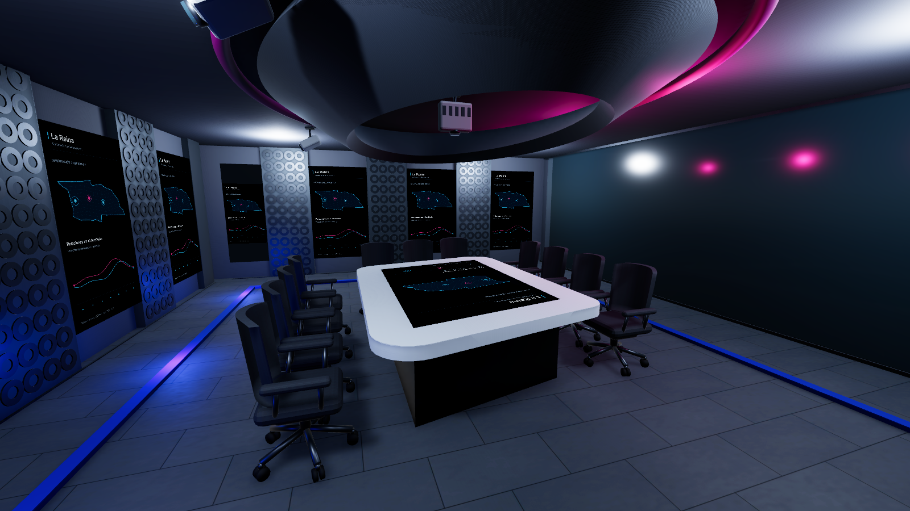</td>
    <td>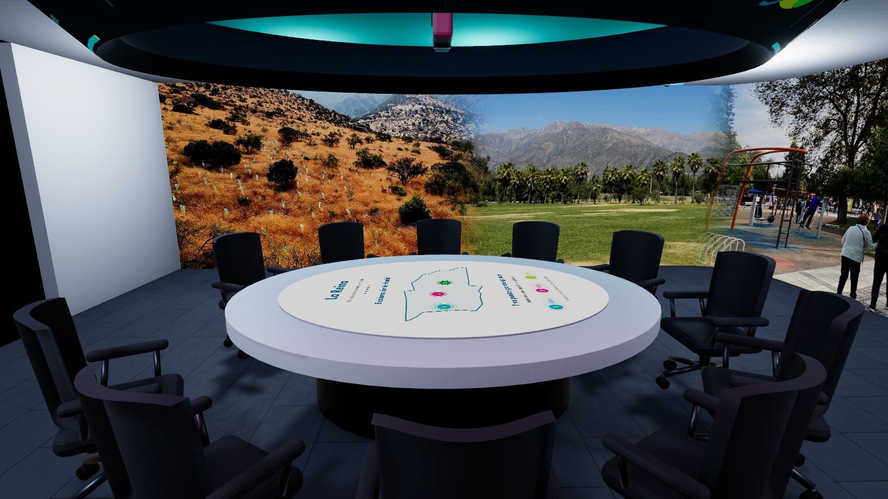</td>
  </tr>
  <tr>
    <td>Panorama de contexto que envuelve la sala.</td>
    <td>Nueva mesa y contenido de demostración dentro del óvalo.</td>
  </tr>
  <tr>
    <td>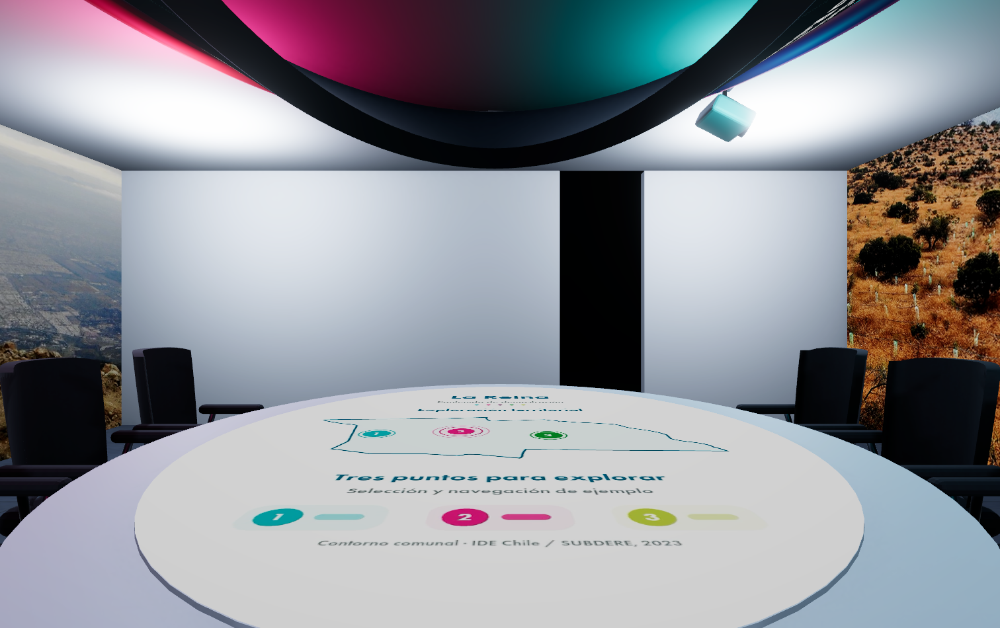</td>
    <td>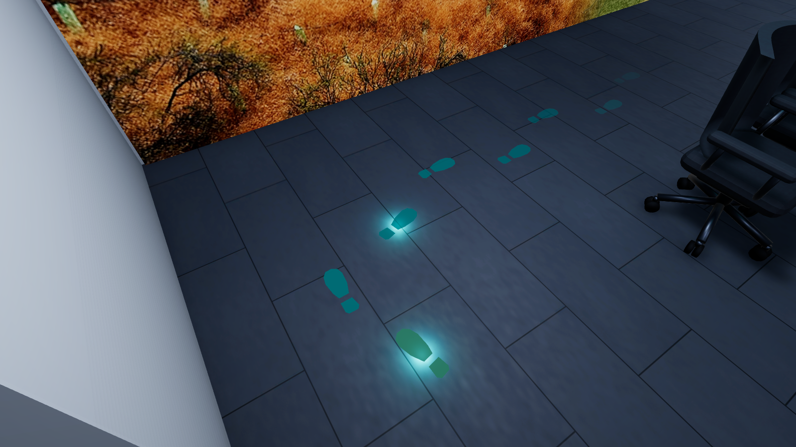</td>
  </tr>
  <tr>
    <td>Registro anterior de la vista sentada, con la cámara a 1,18 m.</td>
    <td>Una huella a la vez, alternando derecha e izquierda.</td>
  </tr>
  <tr>
    <td>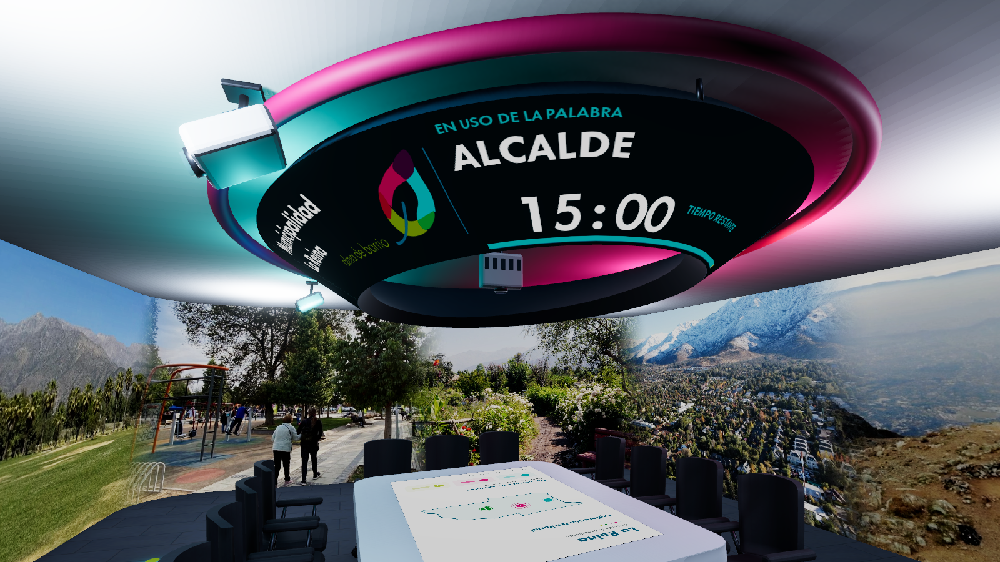</td>
    <td>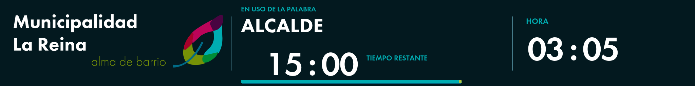</td>
  </tr>
  <tr>
    <td>La información de la sesión rodea la mesa.</td>
    <td>Marca municipal y tiempo restante con la gráfica del proyecto.</td>
  </tr>
  <tr>
    <td>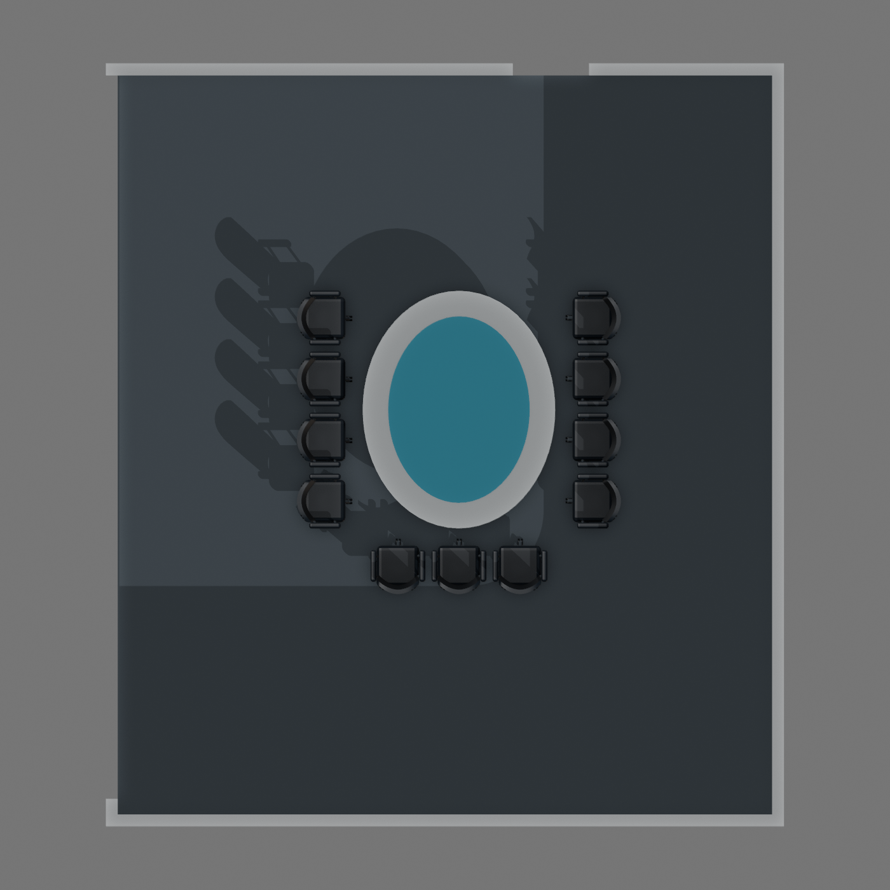</td>
    <td>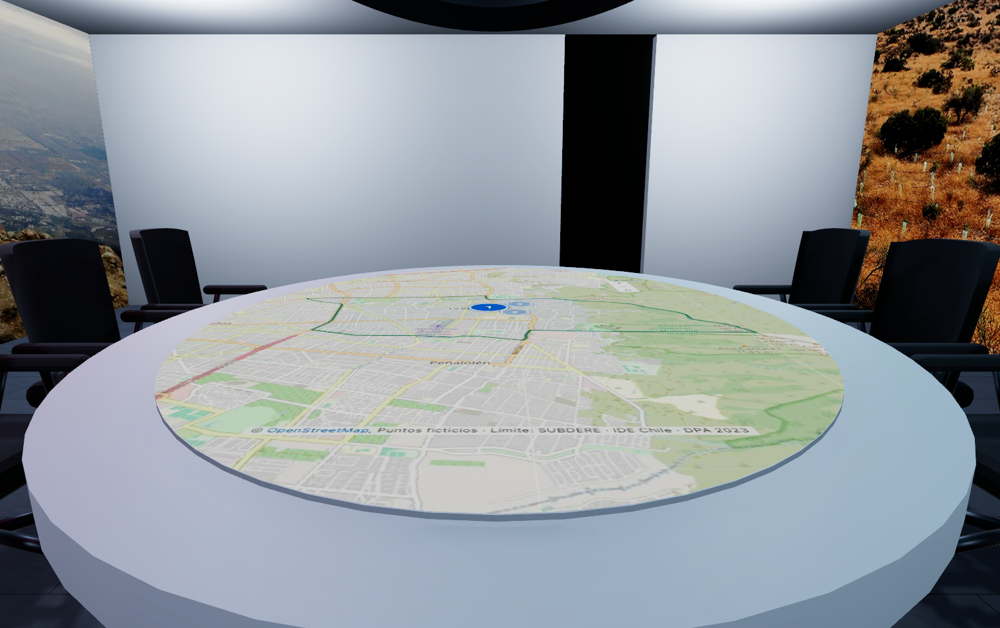</td>
  </tr>
  <tr>
    <td>La U compacta deja abierto el acceso a la mesa.</td>
    <td>El control con las manos se activa solo desde el puesto principal.</td>
  </tr>
  <tr>
    <td></td>
    <td>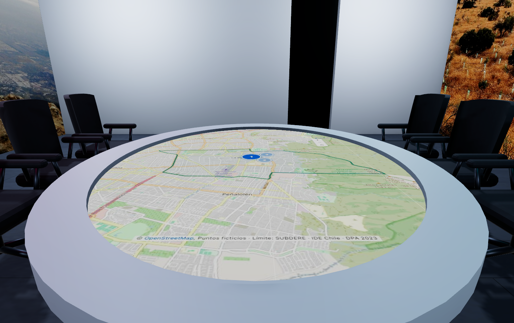</td>
  </tr>
  <tr>
    <td>Borde de 20 cm para dar más espacio al mapa.</td>
    <td>Ajustes de altura para comparar la lectura desde la silla.</td>
  </tr>
  <tr>
    <td>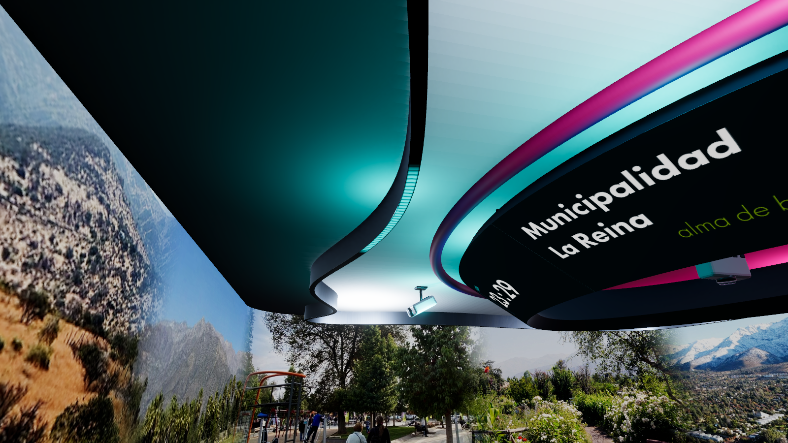</td>
    <td>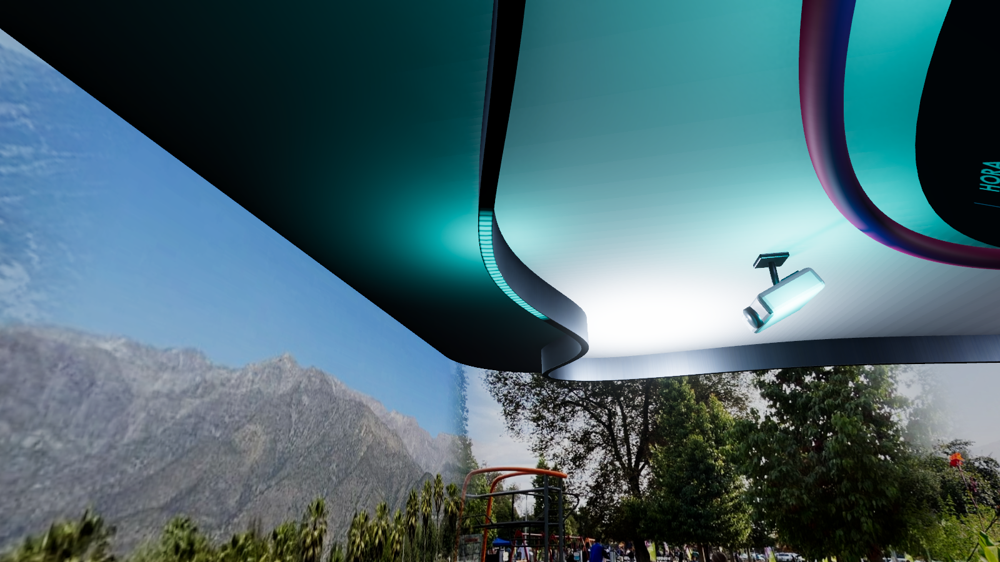</td>
  </tr>
  <tr>
    <td>La curva del modelo se convierte en una guía luminosa.</td>
    <td>La luz se adelanta para indicar hacia dónde seguir caminando.</td>
  </tr>
</table>

Por ahora es una **representación conceptual**, sin datos municipales en tiempo real. Las ubicaciones de los proyectores son provisionales y todavía requieren una revisión en el espacio físico.

También probamos una **copia independiente en Meta Quest 2**, con recorrido, giro continuo y mandos visibles. Esa versión mantiene el mapa como una imagen estática, sin cámara ni gestos. La conexión gestual y los cambios de este avance corresponden a **Mac**; la copia de VR permanece aparte.

**Fuentes:** [propuesta espacial del equipo](../propuestaEspacialMLR/README.md), [referencia gráfica entregada para este avance](./Documentacion/paleta-referencia.json) [fotografías oficiales del panorama](./Documentacion/fuentes-panorama.json) y [marca y tipografía de la pantalla](./Documentacion/ceiling_assets_provenance.json).
