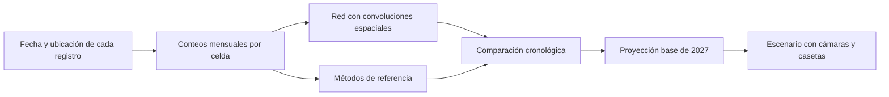

# Pronóstico territorial de robos para 2027

La red neuronal estima cómo podrían repartirse los robos registrados entre los sectores de La Reina. Se entrenó con mapas mensuales y se comparó con tres métodos de referencia. La aplicación usa el método con menor error para mostrar la proyección base de 2027. Desde esa base, permite explorar cómo cambiaría el mapa al agregar cámaras y casetas bajo un supuesto fijo. Los registros de esta entrega son sintéticos.

## De los registros al mapa

La preparación agrupa los 60.000 registros de 2023 a 2025 por mes y por celda. Se obtienen 412 celdas de aproximadamente 250 metros de lado que intersectan la comuna. Una celda sin incidentes registrados en un mes aporta un cero. Los tres mapas mensuales más recientes aportan información de corto plazo. Las medias de 6 y 12 meses, la media histórica y un trimestre comparable del año anterior cuando hay datos resumen patrones más persistentes. El mes del calendario, el horizonte del pronóstico y la disponibilidad de historial comparable completan las entradas de la red.

La red aplica filtros de 3 × 3 a las celdas vecinas. Un bloque residual conserva parte de la señal de entrada y aprende un ajuste. Una de sus convoluciones toma puntos más separados dentro de la cuadrícula, lo que amplía el vecindario que puede influir en cada resultado y conserva la resolución del mapa. Los filtros se comparten entre sectores. La red usa 16 canales internos y tiene 6.545 parámetros entrenables. [He et al., aprendizaje residual](https://arxiv.org/abs/1512.03385) · [Yu y Koltun, convoluciones dilatadas](https://arxiv.org/abs/1511.07122)

La red aprende a corregir la distribución histórica. El ajuste está acotado a ±0,35 en la escala logarítmica para moderar los cambios con una serie corta. Durante el entrenamiento, la entropía cruzada penaliza la diferencia entre el reparto estimado y la proporción de robos registrada en cada celda durante el trimestre objetivo. La función *softmax* transforma los puntajes en proporciones que suman uno dentro de la comuna. El volumen de robos se estima por separado promediando los meses equivalentes del historial y se reparte según esas proporciones. Si se estiman 400 robos en un trimestre y una celda recibe el 2 %, su conteo esperado es 8. La aplicación lee la proyección precalculada y actualiza localmente el mapa al agregar o quitar recursos. [Loshchilov y Hutter, optimización con AdamW](https://arxiv.org/abs/1711.05101)

## Evaluación de la red

La red estima cuatro trimestres desde un mismo punto de partida, con horizontes de 3, 6, 9 y 12 meses. El entrenamiento de desarrollo usó 2023 y evaluó 2024 para seleccionar 35 épocas. La prueba cronológica reajustó la red con datos hasta diciembre de 2024 y pronosticó todo 2025 desde ese corte. Los registros de 2025 se usaron para calcular el error y elegir el método de la aplicación. Como se trata del mismo año sintético evaluado en la versión anterior, la mejora entre versiones requiere confirmarse en otro período. [Validación cronológica de Hyndman y Athanasopoulos](https://otexts.com/fpp3/toolbox.html#time-series-cross-validation) · [Desafío de pronóstico de delitos del Instituto Nacional de Justicia de EE. UU.](https://nij.ojp.gov/funding/real-time-crime-forecasting-challenge-posting)

El **error absoluto medio** indica cuántos robos separan en promedio la estimación y el conteo de prueba por celda. El **error absoluto relativo al total** divide la suma de errores absolutos por el total de la prueba. La **recuperación de focos** indica cuántas de las 42 celdas con más robos en la prueba también aparecen entre las 42 primeras del pronóstico. Las tres mediciones usan conteos por celda antes de suavizar la visualización. [Medición del error absoluto relativo de Hyndman](https://robjhyndman.com/hyndsight/wape.html) · [Evaluación territorial de Chainey et al.](https://discovery.ucl.ac.uk/id/eprint/112873/)

| Método | Error absoluto medio por celda | Error absoluto relativo al total | Recuperación de focos |
|---|---:|---:|---:|
| Repetir el último año | 46,41 | 95,96 % | 23,81 % |
| Promedio de dos años | **43,89** | **90,76 %** | **23,81 %** |
| Promedio de dos años con suavizado espacial | 46,96 | 97,11 % | 16,67 % |
| Red neuronal espaciotemporal | 44,89 | 92,82 % | 23,81 % |

La red actual identificó 10 de los 42 focos, frente a 7 con la red anterior. El error medio de la red pasó de 44,98 a 44,89 por celda. El promedio de dos años identificó los mismos 10 focos que la red actual y logró el menor error, por lo que la base que muestra la aplicación para 2027 es el promedio de los conteos de 2024 y 2025 en cada celda. El conjunto de prueba introduce cambios de concentración programados de un año a otro. El error observado en esa prueba describe ese conjunto sintético. [Comparación de la primera versión](./17-simulacion-futura-robos.md) · [Generador de registros](../scripts/prepare-analysis-data.py) · [Proyección y resultados de la prueba](../public/analysis/pronostico-robos.json)

La red candidata se volvió a entrenar con 2023–2025 y usa una estimación interna de 2026 para pronosticar 2027. Ese horizonte de dos años requiere evaluación adicional. El entrenamiento se reproduce con `node scripts/train-analysis-forecast.mjs` desde la carpeta del proyecto. Usa Python con `torch==2.8.0` en CPU y una semilla fija. Si PyTorch está en un entorno virtual, se puede ejecutar `MLR_PYTHON=/ruta/al/entorno/bin/python node scripts/train-analysis-forecast.mjs`. La app carga el archivo calculado, así que explorar escenarios no requiere instalar PyTorch ni volver a entrenar. [Preparación y comparación](../scripts/train-analysis-forecast.mjs) · [Código de la red](../scripts/train-spatiotemporal-forecast.py)

## Medidas del escenario

Al agregar una cámara monitoreada o una caseta con personal, la aplicación reduce el conteo esperado alrededor del punto. La reducción máxima de una cámara es de 30 % en el punto y su influencia cae hasta desaparecer a 350 metros. La caseta usa 38 % y 550 metros. Las influencias se combinan con rendimientos decrecientes y una reducción máxima de 62 % por celda. Estos valores son parámetros fijos del escenario alto. **Ver antes** y **Ver después** usan la misma escala de color y el mismo año. [Evidencia y evaluación del efecto de las intervenciones](./17-simulacion-futura-robos.md)

El cálculo recorre solo las celdas cercanas a cada medida. Con 300 ubicaciones, una prueba local en Node.js pasó de 1,55 a 0,20 milisegundos por cálculo con el mismo mapa base. La diferencia entre los conteos de ambas implementaciones fue inferior a 6 × 10⁻¹⁴. La prueba midió el cálculo sin incluir el dibujo en pantalla. [Cálculo del escenario](../src/analysis-forecast.js)

Para estimar el efecto local de las medidas hacen falta registros de denuncias y fechas reales de operación, información sobre la cobertura de cámaras y los turnos de las casetas, y sectores comparables para medir los cambios. Una instalación puede modificar la probabilidad de detectar incidentes además de modificar su ocurrencia. La evaluación del efecto usa datos distintos de la prueba de precisión del pronóstico y debe revisar también posibles cambios en sectores vecinos. [Ensign et al., efectos de retroalimentación](https://proceedings.mlr.press/v81/ensign18a.html) · [Gómez, Mejía y Tobón, evaluación de cámaras en Medellín](https://doi.org/10.1002/pam.22280)

## Referentes del diseño

- **Mapas urbanos y series temporales.** DeepCrime combina señales espaciales y temporales por zona para anticipar incidentes urbanos. El estudio de Lv et al. usa una red que combina convoluciones y memoria temporal sobre cuadrículas de Chicago para pronosticar hurtos. La arquitectura de esta entrega aprovecha la representación por celdas y la combinación de ventanas de tiempo, con convoluciones residuales sobre los mapas de entrada. [Huang et al., 2018](https://hub.hku.hk/handle/10722/308773) · [Lv et al., 2022](https://doi.org/10.5194/isprs-archives-XLVIII-3-W2-2022-35-2022) · [Zhang et al., redes residuales para mapas urbanos](https://arxiv.org/abs/1610.00081)
- **Pruebas contra métodos de referencia.** La tesis doctoral de M. O. Adepeju en University College London propone comparar técnicas de pronóstico territorial en Camden y Chicago con métricas complementarias. La tesis doctoral de Nicholas Fisk en King's College London contrasta redes neuronales con modelos estadísticos de referencia y estudia patrones periódicos en registros urbanos. Estos precedentes orientan la comparación entre modelos y las mediciones por zona. [Adepeju, 2017](https://discovery.ucl.ac.uk/id/eprint/1555721/) · [Fisk, 2024](https://kclpure.kcl.ac.uk/portal/en/studentTheses/advancing-spatiotemporal-prediction-using-artifcial-intelligence-/)

Con denuncias reales georreferenciadas se podrá repetir la evaluación en varios cortes cronológicos a uno y dos años, con errores por zona y tipo de robo. La evaluación debería reservar un último período para medir el desempeño del método una vez elegido. Si se quiere probar la extrapolación hacia sectores con pocos antecedentes, la prueba debería reservar bloques geográficos separados. [Roberts et al., validación por bloques](https://doi.org/10.1111/ecog.02881)
