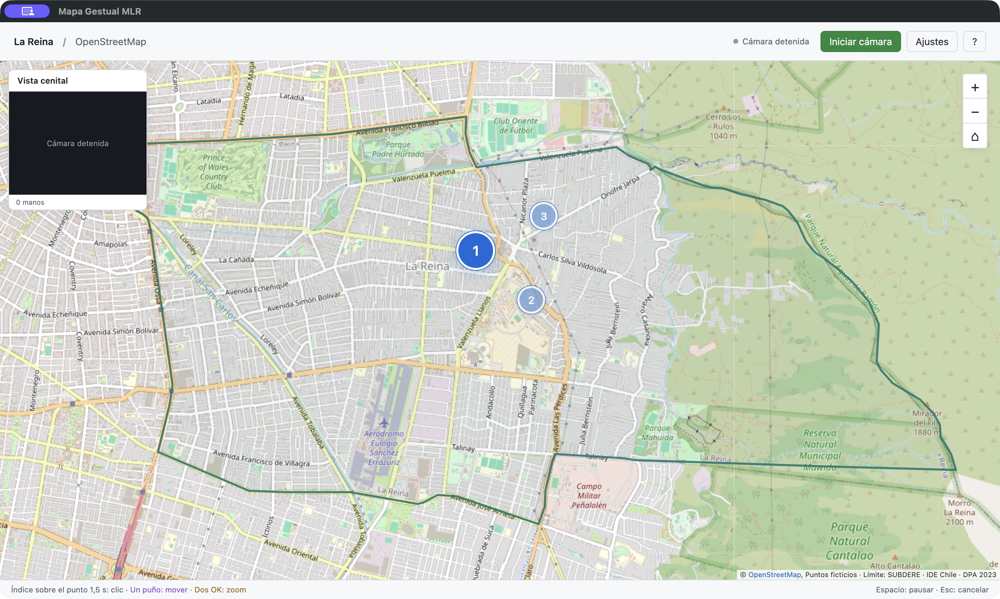
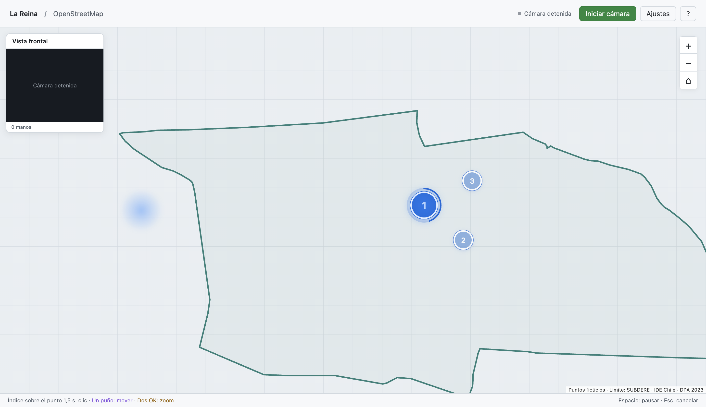
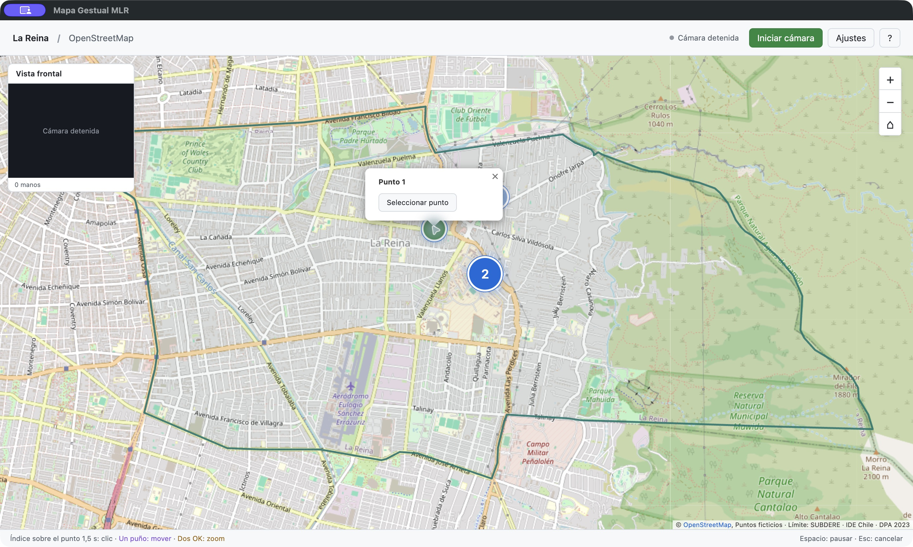
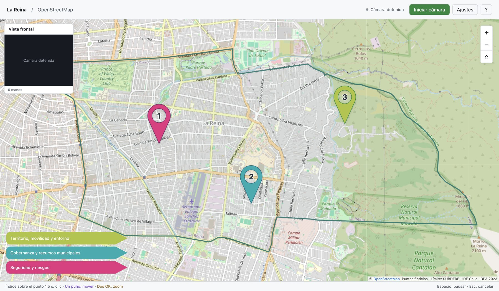
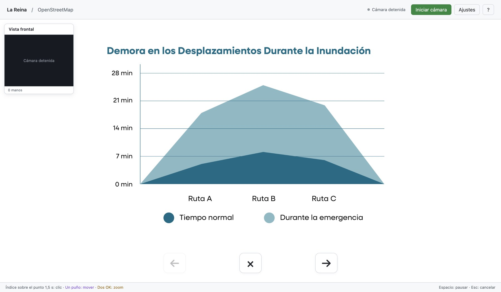
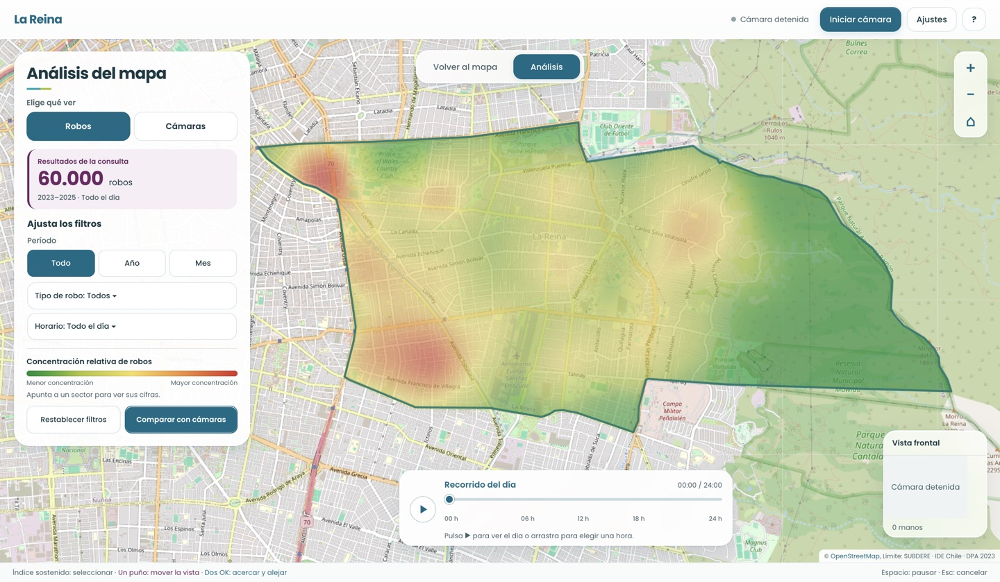
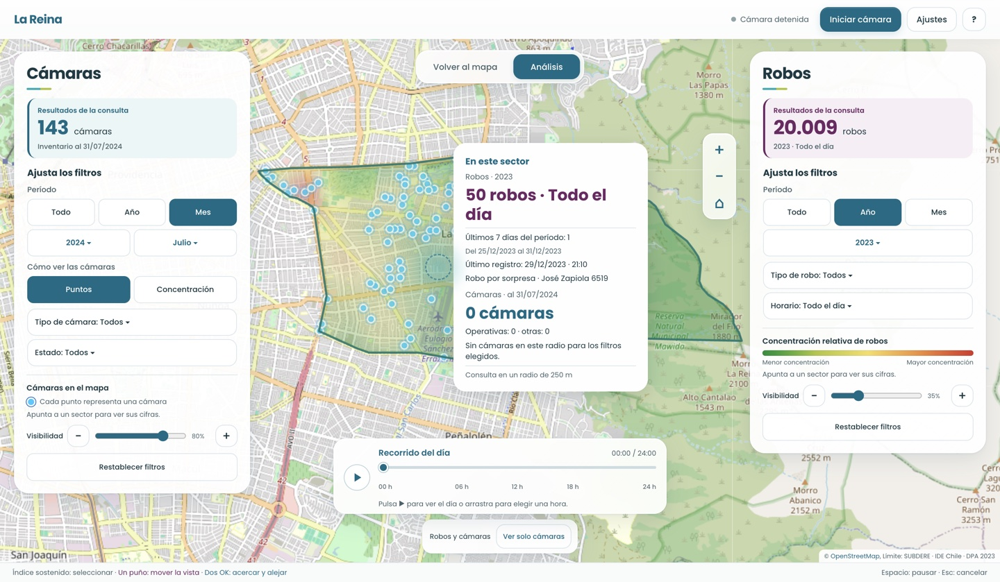

# Bitácora - Mapa Gestual MLR

### Interacción y análisis de información territorial

**Inicio:** 5 de octubre de 2026 
**Última actualización:** 10 de noviembre de 2026 · versión 0.9.2 
**Equipo:** Emilio Abarca · Emilia Armstrong · Victoria Aracena

[Volver al README principal](../README.md) · [Revisar Etapa 2](../Etapa-2/Bitacora/README.md)

---

## Material del prototipo

| Material | Qué muestra |
|:---|:---|
| [Referentes de gestos y UX](./Documentos/02-gestos-y-ux.md) | Antecedentes para definir la interacción. |
| [Análisis territorial](./Documentos/11-analisis-seguridad.md) | Consulta de seguridad, cámaras y cruce de información. |
| [Fuentes de cámaras](./Documentos/12-camaras-fuentes.md) | Procedencia y alcance de la base. |
| [Evaluación integral de usabilidad](./Documentos/14-evaluacion-usabilidad-integral.md) | Heurísticas de Nielsen, recorrido cognitivo y revisión de accesibilidad. |
| [Fuentes de recursos de seguridad](./Documentos/15-fuentes-recursos-seguridad.md) | Puntos fijos y botón de emergencia con ubicación identificada. |

## Punto de partida

En la etapa anterior planteamos reunir información municipal en un mismo mapa. Ahora nos concentramos en cómo recorrerlo con las manos frente a una cámara frontal que apunta hacia la persona. Elegimos MediaPipe para obtener los puntos de las manos y dedicar este avance a probar la interacción.

<table>
  <tr>
    <td align="center">
      
    </td>
  </tr>
  <tr>
    <td><strong>Figura 1.</strong> Mapa del prototipo, contorno comunal y tres puntos ficticios. <strong>Fuente:</strong> captura de la aplicación; base OpenStreetMap y límite SUBDERE DPA 2023.</td>
  </tr>
</table>

## Demostración

<table>
  <tr>
    <td align="center">
      
    </td>
  </tr>
  <tr>
    <td><strong>Video demostrativo.</strong> <a href="https://youtu.be/mBsh8tRpk8A">Test software visualización de datos MLR</a>. Hacer clic en la imagen para ver el funcionamiento en YouTube.</td>
  </tr>
</table>

## Lo que fuimos cambiando

La palma abierta a veces movía el mapa sin querer. Por eso cambiamos el desplazamiento a un puño cerrado y permitimos hacerlo con una sola mano. Mantuvimos dos OK para el zoom: separar las manos acerca el mapa y juntarlas lo aleja.

El OK fallaba para seleccionar en algunos ángulos. Probamos señalar con el índice, pero exigir los demás dedos retraídos también bloqueaba la selección. Finalmente dejamos que baste con mantener la punta del índice sobre el punto durante **1,5 segundos**, sin importar los otros dedos. Acortamos la espera para que sea más ágil y dejamos un margen amplio para el pulso. El aro muestra cuánto falta y una segunda mano puede acompañar la selección; dos OK cambian al zoom.

<table>
  <tr>
    <td align="center">
      
    </td>
  </tr>
  <tr>
    <td><strong>Figura 2.</strong> Aro de carga y sombras durante la selección. <strong>Fuente:</strong> captura de una prueba automatizada del prototipo, con posiciones de manos simuladas.</td>
  </tr>
</table>

Dejamos una sombra por mano y colores distintos para desplazamiento y zoom, para entender el modo sin agregar iconos. La cámara pequeña permite revisar el seguimiento, y todo su encuadre corresponde al mapa para alcanzar los bordes. Los tres puntos se activan en orden para guiar la prueba; el contorno de La Reina ayuda a ubicarla en la comuna.

<table>
  <tr>
    <td align="center">
      
    </td>
  </tr>
  <tr>
    <td><strong>Figura 3.</strong> Información del primer punto y avance al segundo. <strong>Fuente:</strong> captura de la aplicación, abierta con clic para registrar la interfaz.</td>
  </tr>
</table>

## Del mapa a los gráficos

Incorporamos la gráfica actualizada del equipo para probar cómo pasamos del territorio a la información. El **pin 1, magenta de Seguridad y riesgos**, abre los cinco gráficos de las páginas 2 a 6 del PDF, en el mismo orden. Son materiales de trabajo del equipo, no datos municipales validados.

Dejamos siempre visibles la **X para volver al mapa** y las **flechas para cambiar de gráfico**. Se seleccionan manteniendo el índice durante **1,5 segundos**, igual que los puntos. También podemos acercar la información con dos OK y arrastrarla con un puño, para conservar una sola forma de interactuar.

Separamos los tres puntos y usamos los pines originales del PDF, con sus colores y una leyenda pequeña abajo al centro. El primero crece y se achica suavemente para invitar a comenzar, sin cambiar de tono. Los otros dos temas quedan con su contenido en preparación. Al probar la proyección en la mesa, acercamos los gráficos a la persona sentada y movimos las flechas a los extremos, con la X encima del contenido.

<table>
  <tr>
    <td></td>
    <td></td>
  </tr>
  <tr>
    <td><strong>Figura 4.</strong> Pines y leyenda temática. <strong>Fuente:</strong> captura de la aplicación.</td>
    <td>El pin 1 abre los gráficos, con controles que también se seleccionan con el índice.</td>
  </tr>
</table>

## Actualización: análisis territorial

**Fecha:** 6 de noviembre de 2026

### Seguridad sobre el mapa

Incorporamos **Análisis** sobre el mismo mapa de La Reina. Preparamos **60.000 incidentes de demostración entre 2023 y 2025** y un mapa de calor que pasa de verde a rojo según su concentración. La consulta combina período, horario y cuatro grupos de robo: **violencia o intimidación, por sorpresa, de vehículos y en inmuebles**.

Primero elegimos **Todo, Año o Mes** y luego el período concreto. Al pasar el mouse o el índice sobre el mapa aparece una ficha del sector: total, últimos siete días del período y registro más reciente. Ajustamos los focos por año y mes para comparar cambios en el territorio.

<table>
  <tr>
    <td align="center"></td>
  </tr>
  <tr>
    <td><strong>Figura 5.</strong> Consulta de seguridad sobre la cartografía de La Reina. <strong>Fuente:</strong> captura de la aplicación con datos de demostración.</td>
  </tr>
</table>

### Cámaras y cruce de información

Sumamos una segunda base con **320 emplazamientos de cámaras**, visibles como puntos cian o mapa de calor azul. **Añadir comparación** superpone una segunda capa y conserva filtros y visibilidad independientes, con un panel a cada lado. Preparamos un ejemplo de **2024** con concentraciones de incidentes y pocas cámaras cercanas para mostrar esta lectura conjunta.

<table>
  <tr>
    <td align="center"></td>
  </tr>
  <tr>
    <td><strong>Figura 6.</strong> Consulta conjunta de ambas bases y detalle de un sector. <strong>Fuente:</strong> captura de la aplicación con datos de demostración.</td>
  </tr>
</table>

### Ajustes de la interfaz

Ordenamos Análisis en **capa, resultados y filtros**. Horario, tipos y fechas se despliegan solo cuando se necesitan. Los paneles usan superficies blancas con cifras en azul petróleo y **Poppins** como alternativa a **Neulis Sans**.

La **barra de 00 a 24 horas** reproduce el día en **ocho segundos**, con pausa y deslizador. Mezcla gradualmente los cuatro horarios de robos y conserva los demás filtros. En el cruce, las cámaras permanecen fijas. La [evaluación de la interfaz](./Documentos/13-evaluacion-analisis.md) reúne los cambios y las capas sugeridas.

Los incidentes son simulados y las cámaras combinan referencias publicadas con emplazamientos de demostración. La procedencia permanece en los CSV y sus metadatos; estas bases no representan estadísticas ni un catastro municipal vigente. Las agrupaciones de robo se apoyan en el [glosario de la Biblioteca del Congreso Nacional](https://www.bcn.cl/siit/reportescomunales/glosario.html).

## Actualización: usabilidad y recursos de seguridad

**Fecha:** 10 de noviembre de 2026

Los gráficos de inundación se abren desde el mapa principal y el visor muestra el título y el avance. La ayuda de gestos y los ajustes técnicos se abren a demanda. [Evaluación integral](./Documentos/14-evaluacion-usabilidad-integral.md)

El catálogo agrupa **Incidentes y vigilancia** y **Recursos de seguridad**. Se puede elegir una capa y comparar con otra. Los puntos fijos y los botones se muestran como referencias territoriales para análisis. [Fuentes y ubicaciones](./Documentos/15-fuentes-recursos-seguridad.md)

Al apuntar al mapa aparece la ficha de 250 metros. Se puede fijar con clic y cerrar con Escape. La ficha de cada botón muestra sus pulsaciones de referencia y **Más usados** filtra los diez con mayor conteo. Los puntos fijos también tienen una lista de ubicaciones.

## Próximos pasos

- Probar la consulta y el cruce con usuarios.
- Incorporar bases municipales verificadas cuando estén disponibles.

---

Documentado por Emilio Abarca, Emilia Armstrong y Victoria Aracena, 2026.

[Volver al README principal](../README.md)
